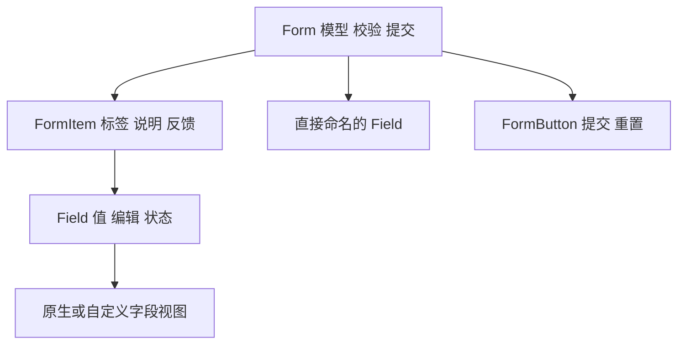

# 表单套件设计草案

`@reactive-mp/components/form` 提供微信小程序表单状态、校验、字段组件与组合 Hooks。组件具有可直接使用的结构和少量特征版式，应用可以替换外观、组合字段或用 Hooks 驱动原生控件。

状态：设计稿。本文中的组件、签名和示例用于确定实现合同，尚不是已发布或已实现的 API。设计与正式使用文档分开维护。

## 组件职责与依赖

Form 持有一份规范模型，统一管理字段注册、规则执行、错误与提交。FormItem 负责标签、说明、插槽和状态反馈。Field 负责一个逻辑值及其编辑交互。FormButton 只发起提交或重置并反映操作状态，不参与字段注册。



命名的 FormItem 关联一个逻辑字段，字段可由多个原生控件组成。内部 Field 省略 name 时继承 Item 的名称；显式声明时必须与 Item 一致，否则报告配置错误。同一路径只允许一个字段所有者，重复注册不能静默覆盖。FormItem 只提供上下文，不再额外注册一份字段。

未命名的 FormItem 可作纯版式容器，不向多个子字段附加同一组规则。多个字段的分组通过普通布局和各自的 FormItem 组合，不额外建立一层模型。

既未声明 name、也不能继承名称的 Field 按独立字段运行，不自动猜测模型路径。Form 收集来自字段协议，不能把原生 input 的 name 或 button 的 form-type 当作已完成接线。

form 是 components 统一包的内部领域，复用 runtime 和 reactivity。领域入口导出 Hooks、类型及必要工具；组件通过 `@reactive-mp/components/form/components/<name>/index` 注册。不引入应用 Store、网络 SDK、账号、路由或埋点。视频预览通过自定义预览事件或插槽接入，不让 Form 强依赖视频领域。

## 字段组件与共用逻辑

| 组件 | 值 | 保留的能力 | 共享实现 |
| --- | --- | --- | --- |
| input | string | 原生输入类型、占位、焦点、键盘事件、长度限制 | useField |
| textarea | string | 自动高度、计数、最大长度、确认与焦点事件 | useField |
| checkbox | boolean | 独立勾选、标签插槽、禁用 | useChoice |
| switch | boolean | 开关版式、标签、禁用 | useChoice |
| radio-group | string 或 number | 互斥单选；列表和按钮版式 | useChoice |
| checkbox-group | 值数组 | 多选；列表和按钮版式；折叠与展开 | useChoice |
| select | 单个值或值数组 | 原生单选、弹窗单选或多选、单列或双列、选中摘要 | useSelect |
| column-picker | 值数组，每列一个值 | 独立多列选择、列范围更新、值与索引转换 | useSelect |
| date-picker | string | 日期或时间选择、范围、初始滚轮位置 | useSelect |
| region-picker | string 数组 | 原生地区选择、级别、名称与编码详情 | useSelect |
| cascader | 值路径数组 | 外部树数据、多级联动、清除无效下级、延迟数据接入 | useCascader |
| calendar | string | 月份网格、前后翻月、日期范围、禁用日期 | useCalendar |
| upload | FileValue 数组 | 单文件卡片、多文件列表、图片和视频、选择、上传、重试、预览和删除 | useUpload |

Boolean Checkbox 与 RadioGroup 含义不同。单文件上传使用数组，通过 `maxCount=1` 和 `variant='single'` 表达；单文件与多文件共享值结构和任务流程。

Input、Textarea 默认不附加长度上限，显式配置 maxlength 后按同一规则限制与计数；不把手机号格式、姓名字符范围或 Emoji 策略内置为输入类型。Hooks 可以传入 parse/format，普通组件可由应用包装为专用字段。原生事件中的 cursor、keyCode 等信息随原始 detail 保留。

Select 的 `presentation` 为 native 或 popup，默认 native；native 只提供单选，multiple 仅适用于 popup。ColumnPicker 的多列分别选择一个值，与多选列表分开；存在树状上下级关系时使用 Cascader。按钮组选项的折叠由 collapseAfter 控制，默认不折叠；选项变化后重新测量。

DatePicker 用 mode 区分 date/time，日期范围和初始滚轮位置由外部配置。Calendar 默认允许选择过去和未来日期，通过 min/max 和禁用规则限制；不内置门店、可预约时段或活动状态。

重复行作为 `useFieldArray` 能力提供，组件内容由应用组合。首版不提供带业务含义的日期列表，也不建立 JSON Schema 页面生成器。

## 模型与字段生命周期

### 数据所有权

Form 控制器始终拥有唯一的规范模型。字段连接 Form 后从该模型读取值，不重复保存一份已提交值。弹窗草稿、上传任务和输入显示格式属于交互状态。

外部输入分为 initialValues 和 model：

| 输入或操作 | 语义 |
| --- | --- |
| initialValues | 默认空对象；初始化和重置基线；后续修改该属性不覆盖用户输入 |
| model | 默认未设置；外部同步快照；初始化时优先于 initialValues，后续不同快照同步进模型 |
| 字段 defaultValue | 首次注册且模型不存在该路径时补入模型与基线；不覆盖 false、0、空串或已有空数组 |
| 字段 value | 独立使用时的外部同步输入；连接 Form 后由表单模型提供，不允许另设并行数据源 |
| setFieldValue / setValues | 修改规范模型，触发必要的状态失效、联动校验与 change |
| reset(values?) | 取消旧任务与校验，清除错误和交互状态；传 values 时建立新基线，否则恢复已有基线 |

model 是外部同步入口，不是等待父组件批准才能编辑的严格受控模式。编辑先提交控制器，再通知父页面；父页面回写相等快照不会重置 dirty、重复校验或再次发出 change。不同的外部快照会更新值与派生状态，仅元状态改变时发出 statechange，不回发 change 形成反馈循环。

异步载入记录并希望把它视作初始值时，显式使用 reset(loadedValues)。普通外部 model 更新不会悄悄重建 dirty 基线。快照是纯数据，不传入 Signal、组件实例、函数、文件任务或 Promise。

### 路径与参与范围

name 支持 `contact.email`、`contacts[0].email`；JS 接口也接受路径段数组，以表达包含点号的字面键。内部统一为路径段，不混用扁平对象键与 setData 路径。数组行身份由稳定 rowKey 维护，位置改变时同步值、字段路径与状态。

Form.validate 默认只检查当前注册且 active、未禁用的字段。rules 是规则配置，不会仅因出现一个键就创造字段；无需视图的逻辑字段可由 useField 注册。完全脱离组件、只校验一份数据时使用 `validateValues(values, rules, options)`，明确按给定规则键检查，不借用渲染注册状态。

| 变化 | 模型 | 校验与交互状态 |
| --- | --- | --- |
| 字段首次挂载 | 读取已有值，缺失时补默认值 | 初始为 idle，默认不展示错误 |
| active=false 或 disabled=true | 保留值 | 退出当前校验与提交阻塞，取消旧校验 |
| 字段卸载，preserve=true 默认值 | 保留值和基线 | 注销所有者，移除该实例的错误、pending 和监听 |
| 字段卸载，preserve=false | 删除值及基线路径 | 注销并清理；产生一次模型变更 |
| 字段改名或迁移 Form | 按旧字段的 preserve 规则处理，再读取新路径 | 先注销旧作用域，旧结果不得写入新字段 |
| readonly=true | 保留值，禁止交互修改 | 仍参与校验，与 disabled 分开 |

隐藏但仍挂载的字段需要显式设 active=false；仅通过 CSS 隐藏不会改变参与范围。提交快照默认包含模型中的保留值，应用可在提交处理时投影接口数据；退出校验不等于自动删除数据。

禁用状态按 Form、FormItem、Field 的逻辑或继承，下层 false 不能解除上层禁用。两个 Form 分别拥有注册表、模型、适配器和校验任务。嵌套时字段归属最近 Form，不向外层重复收集。

## 规则与校验状态

### 规则合同

规则按 Form、FormItem、Field 的顺序合并，层内保留声明顺序。内建约束与自定义 validator 各执行一次，自定义函数不替代 required、长度或 pattern。每字段默认保留第一个失败结果，同时仍检查其他字段。

```ts
type ValidatorResult = true | false | string;
type Validator = (
  value: unknown,
  context: {
    path: readonly (string | number)[];
    label: string;
    values: Readonly<Record<string, unknown>>;
    isCurrent(): boolean;
  },
) => ValidatorResult | Promise<ValidatorResult>;

interface Rule {
  required?: boolean;
  type?: 'string' | 'number' | 'boolean' | 'array' | 'object';
  minLength?: number;
  maxLength?: number;
  min?: number;
  max?: number;
  pattern?: string;
  flags?: string;
  accepted?: boolean;
  validator?: string | Validator;
  message?: string;
  trigger?: 'input' | 'change' | 'blur' | ('input' | 'change' | 'blur')[];
  dependencies?: string[];
  debounce?: number;
}
```

validator 返回 true 表示通过，false 使用规则或默认错误，非空字符串作为错误文案；空字符串按通过处理。同步和异步使用同一结果协议，不保留多种布尔含义或元组约定。意外异常发出 error 并使本次校验失败，不把 Promise 转成错误字符串。

required 只判断缺失或为空：undefined、null、空串、空数组；字符串默认不 trim。false、0 有值，NaN 和无穷数不属于合法 number。必须勾选用 accepted，与“是否提供 Boolean”分开。非必填空值跳过其他内建约束，但显式 validator 仍执行。长度作用于字符串和数组，数值范围由 min/max 表达；字符串计数统一按 Unicode 码点，不暗示等同于用户感知的字形数量。

WXML 传入的规则是纯数据，pattern 使用字符串与 flags。自定义 validator 可用名称引用，由普通页面调用 `form.setValidators({ name: fn })` 注册；Hooks 在 JS options.validators 中传入同样的实例级注册表，也可以直接使用函数规则。找不到名称属于配置错误，不能当作通过。动态修改注册表或规则会使相关结果失效。

独立 Field 通过自己的 setValidators 或 Hook options.validators 注册，连接 Form 后统一使用该 Form 的注册表。内建规则由同一目录维护；默认消息可通过 options.messages 或实例 setMessages 覆盖，不把业务规则和文案写死在引擎中。

### 触发和异步隔离

Input、Textarea 默认 blur 校验，选择类字段默认 change 校验。已有可见错误的文本字段在 input 时重新校验；显式 rule.trigger 优先。提交和显式 validate 检查所有适用规则，不受交互 trigger 限制。结果按规则分别保存，校验子集不覆盖其他规则；当前版本仍有未执行规则时不能标记为 valid。没有匹配规则的事件不清除其他规则的错误。

值改变时标记相关结果过期。dependencies 声明的字段变化会安排一次依赖校验；一次批次每个字段最多执行一次，依赖环不递归触发。没有声明依赖的远程规则不因无关字段输入反复请求。debounce 默认 0，仅用于交互触发，提交时立即执行。

每次任务捕获字段所有者、值版本、规则版本与依赖版本。旧结果、卸载后结果、reset 前结果都不能回写。context.values 是本次校验快照；isCurrent 用于外部异步工作检查自身结果是否仍有效。平台支持的取消由适配器处理，正确性不依赖请求一定能取消。

`validate({ paths?, silent? })` 返回 Promise，结果为 `{ status, values, errors }`，status 为 valid、invalid 或 superseded。省略 paths 时检查全部参与字段；silent 只抑制反馈展示。值、规则或字段参与范围在等待期间变化，旧批次返回 superseded，不发出基于旧快照的 submit/invalid。调用方决定是否对当前状态重试，库不无限循环提交。

### 有效性与错误展示

字段暴露 value、dirty、touched、status、errors、errorMessage、pending；Form 暴露 values、dirty、touched、status、valid、validating、pending、submitting、canSubmit。status 为 idle、validating、valid、invalid，valid 只有在所有参与字段的当前适用规则均已通过、且没有外部错误时才为 true。无参与字段或无适用规则的字段视为通过。

errors 为有序纯数据数组，每项含 path 段数组、message、source（rule 或 external）及可选 rule 名称，按字段注册顺序和规则顺序输出。外部错误优先展示，errorMessage 是可见的第一条文案；getFieldState(path) 可读取指定字段状态，不要求业务解析错误数组。

规则错误和外部错误分别保存。`setFieldError(path, message)` 设置外部错误；传 null 清除该外部错误。外部错误默认在字段值改变、reset 或所有者注销时失效，不被一次同步校验或 submit 直接抹掉。与业务状态绑定更久的错误由应用重新设置或表达为 validator。

`hideErrors(paths?)` 只隐藏反馈，不改变错误事实或 valid。touched、提交尝试和 hideErrors 共同控制可见性，下一次适用校验可重新展示反馈。错误文案是否显示、字段是否有效、按钮是否允许发起一次校验是不同状态。

## 提交和事件

提交先检查 disabled、pending、submitting 等操作状态，再校验当前参与字段；valid 时产生 submit 快照，invalid 时产生错误与首个失败路径。默认允许点击尚未通过校验的提交按钮，以展示问题。可选 `requireValid=true` 只允许已知 valid 状态，未知状态也禁用；这种用法应搭配 `validateOnMount=true` 或显式静默校验。

默认 validateOnMount=false，挂载不启动远程校验，也不展示错误。输入使已验证结果过期后，requireValid 按未知状态禁用，直到对应规则再次执行；不会为满足按钮状态而暗中忽略 trigger 或调用远程接口。

普通组件通过 submitting 属性接受业务请求状态，事件监听器的 Promise 不会被自动等待。Hooks 的 `handleSubmit(handler)` 包装提交、await handler 与 finally 解锁，整个操作期间拒绝重复提交。业务 handler 发生异常时发出 error 并恢复操作状态，字段错误通过独立接口设置。

canSubmit 表示当前可发起提交尝试，默认不等同于 valid；它排除根禁用、进行中的提交校验、上传阻塞和业务提交状态。当前参与字段的普通后台校验可被提交批次接管，不能遗留两份互相覆盖的校验结果。

| 发出方和事件 | detail 与用途 |
| --- | --- |
| Field change | value、previousValue、source；向业务观察者报告实际值改变 |
| Field input / focus / blur / confirm | 保留原生 detail，并附字段路径；输入不重复发出相同的值变更 |
| Form change | path 或 changes、values、source；一次事务只有一次模型通知 |
| Form statechange | valid、status、dirty、touched、validating、pending、submitting、canSubmit；仅元状态改变时通知 |
| Form validate | status、values、errors；完整校验批次的结果 |
| Form submit | values；当前有效且无操作阻塞的快照 |
| Form invalid | errors、firstErrorPath；当前批次的校验失败 |
| Form reset | values；重置后的快照 |
| Select open / close / cancel | 当前值与关闭原因，close 在真正关闭后发出一次 |
| Upload select / uploadstart / progress / uploadsuccess / uploaderror / remove / preview | 文件身份与当前任务事实；不包含业务埋点字段 |
| 各层 error | type、path、message；配置或执行异常，与普通校验失败分开 |

事件默认不依赖跨组件冒泡。Form 直接从控制器汇总 change，不靠旁听任意后代的同名事件。detail 使用独立纯数据快照，不暴露内部可变对象；用户操作、method、reset、upload 等 source 可区分，外部 model 回写不会制造一次用户输入事件。

submit() 返回 Promise，status 为 submitted、invalid、blocked 或 superseded，blocked 附操作阻塞原因。正常的校验失败不通过异常通道表达；handleSubmit 在有效提交时以 values 调用 handler 并等待结束。

## 选择和上传协议

### 选项与草稿

选项默认 `{ label, value, disabled? }`，value 为 string 或 number；通过 labelKey/valueKey/childrenKey 映射外部数据，不在组件内提供业务字典。0 和空串可以是合法选项值，不使用真假过滤去重。选项值在各自作用域内唯一。

单选输出值，多选输出值数组。原生 Picker 的 index 只用于视图定位，不能进入规范模型。change 可以附 selectedOptions，仍以 value 为唯一模型输入。选项异步加载时保留已有值，标签未知时显示值；选项删除不悄悄清值，必选项有效性由规则判断。

弹窗打开时复制已提交值为 draft；勾选只改变 draft，确认后一次性提交，取消丢弃。弹窗打开期间外部值或 options 改变，关闭并丢弃旧草稿，避免旧确认覆盖新输入。摘要默认显示前两个标签及剩余数量，可用 summary 插槽替换。

Cascader 模型统一为每一级的 value 数组，显示用 label 数组；不混合编码与名称。上级改变只截断其后路径。children 数据未加载与已加载的空 children 分开表示；延迟数据通过 loadchildren 事件请求，由外部更新 options，不由字段请求业务接口。载入期间禁止确认不完整路径。

### 文件值与上传任务

```ts
interface FileValue {
  id: string;
  type: 'image' | 'video';
  name?: string;
  size?: number;
  url?: string;
  tempFilePath?: string;
  poster?: string;
}

type UploadAdapter = (
  file: Readonly<FileValue>,
  context: { onProgress(percent: number): void },
) => {
  result: Promise<{ url: string; poster?: string }>;
  abort?(): void;
};
```

文件值与任务分开：控制器的任务表保存 selected、uploading、success、error、cancelled、progress、attempt 和取消句柄，不把 Promise 或进度逐帧写入整个表单模型。每次重试保留文件 id，增加任务版本，迟到结果不能恢复已删除文件。

未指定 adapter 时只选择文件，选中值携带 tempFilePath，可由业务处理。指定 adapter 后默认选中即上传，autoUpload=false 可由 upload() 发起；找不到指定适配器时报告配置错误，不自动降级为选择模式。普通页面通过 Form.setUploadAdapters 注册，独立 Upload 通过 setAdapter 注册，Hooks 直接传入 adapter。

上传模式中的本地文件先进入任务视图，成功后才以含 url 的 FileValue 加入模型；失败项留在任务视图供重试，不伪装成成功值。待上传、进行中和未处理失败均阻塞该字段的提交，删除或成功后解除。选择模式中的 selected 已是有效选择，不以未上传为由阻塞。

默认接受 image，maxCount=9，不额外限制字节大小，retryCount=0；类型、总数量、每类数量、每类大小与重试次数均可配置。数量上限包含进行中任务；选择顺序决定最终顺序，不能按并发完成顺序追加。多次选择、并发删除与取消均按稳定 id 处理。

上传请求地址、认证、签名、响应解析和错误码翻译属于 adapter。组件提供局部状态和通用事件，Toast、全页 Loading、权限说明与全屏预览由业务处理。卸载会释放任务所有权；即使网络操作不能取消，也忽略后续回写。

## 默认版式与扩展

默认提供可用的结构，不附带品牌字体或资源路径。FormItem 提供 label、label-extra、description、默认字段内容、suffix、help、error 插槽；有对应插槽时替换该区域默认内容。组件定义 CSS 变量和 external classes，不依赖页面全局 class。

| 范围 | 默认及可选版式 |
| --- | --- |
| FormItem | labelPlacement=top；可选 left；标签区和字段区各自承担对齐 |
| 字段表面 | appearance=plain；可选 underline、outline；边框与内边距仅由字段表面持有 |
| 反馈区 | 错误优先于辅助说明；参与正常文档流，长度增加时推开下方内容 |
| 选项组 | 列表或按钮；按钮组支持换行和可配置折叠 |
| 弹窗选择 | 标题、内容、选项、底部操作区域；确认和取消行为固定，内容可扩展 |
| 上传 | 网格列表或单文件卡片；只读、删除、重试与预览保持同一状态协议 |

间距、颜色、字体大小、边框、圆角通过变量覆盖，组件自身持有默认值。FormItem 负责区域之间的间距，Field 负责交互表面的内边距，不在两层重复加边框。长标签、两行错误、计数和自定义后缀必须一起验证，不靠固定高度和绝对定位容纳反馈。

Calendar 的月份和星期文案通过展示配置提供。箭头、勾选和删除等简单图形使用包内可交付资源或 CSS，允许替换图标区域。

## Hooks 与使用方式

| 接口 | 职责 |
| --- | --- |
| useForm(input, options) | 规范模型、注册、元状态、校验、提交与实例清理 |
| useFormItem(props, options) | 绑定最近 Form，提供标签、规则、禁用与版式上下文 |
| useField(props, options) | 一个逻辑字段的注册、值、错误、焦点及原生事件适配；options.form 可显式指定 |
| useChoice / useSelect | 布尔和选项选择、值映射、弹窗草稿与确认 |
| useCascader / useCalendar | 路径联动与日期网格，不请求业务数据 |
| useUpload | 选择、任务、并发、重试、移除与上传阻塞 |
| useFieldArray(form, path, options) | append、remove、move、replace 和带稳定 key 的 rows；不生成行内业务内容 |
| validateValues(values, rules, options) | 不依赖宿主和字段注册的纯数据校验，使用相同规则引擎 |

Form 公开 getValues、getFieldState、setFieldValue、setValues、setFieldError、hideErrors、validate、submit、reset、setValidators、setMessages、setUploadAdapters。Hooks 额外提供 handleSubmit。独立 Field 可以使用自身 value/defaultValue 与规则，不要求必须包在 Form 或 FormItem 内。

Hook 返回的视图值为 Signal，方法为普通函数；控制器、注册表与任务对象留在闭包中。消费者只返回模板需要的 Signal 和方法，不把整个控制器作为页面 data 暴露。

FieldArray 的 rows 是含 key、index、path、value 的视图项。append/remove/move 保持现有行身份并同步重排字段状态；删除行由数组事务永久移除对应值，不受行内字段 preserve=true 影响。options.itemKey 可指定数据中的唯一键供外部数组替换时对齐；未指定时，整表 replace/model 替换生成新行身份并清理旧校验状态，不凭索引猜测对象身份。

### 普通页面使用组件

以下是拟定接口的最小接线；所有业务自定义校验都留在 JS，WXML 只传规则数据。

```json
{
  "usingComponents": {
    "rmp-form": "@reactive-mp/components/form/components/form/index",
    "rmp-form-item": "@reactive-mp/components/form/components/form-item/index",
    "rmp-input": "@reactive-mp/components/form/components/input/index",
    "rmp-form-button": "@reactive-mp/components/form/components/form-button/index"
  }
}
```

```js
Page({
  data: {
    model: { email: '' },
    rules: { email: [{ required: true, message: '请输入邮箱' }] },
  },
  onFormChange(event) {
    this.setData({ model: event.detail.values });
  },
  onSubmit(event) {
    console.log(event.detail.values);
  },
});
```

```xml
<rmp-form id="form" model="{{model}}" rules="{{rules}}"
  bind:change="onFormChange" bind:submit="onSubmit">
  <rmp-form-item name="email" label="邮箱">
    <rmp-input type="text" placeholder="请输入邮箱" />
  </rmp-form-item>
  <rmp-form-button action="submit">提交</rmp-form-button>
</rmp-form>
```

### Reactive 页面使用相同组件

沿用上面的 JSON 与 WXML，仅替换页面 JS。普通页面和 Reactive 页面消费同一套组件，不为页面框架复制字段实现。

```js
import { definePage, useSignal } from 'reactive-mp';

definePage(() => {
  const [model, setModel] = useSignal({ email: '' });
  return {
    model,
    rules: { email: [{ required: true, message: '请输入邮箱' }] },
    onFormChange: (event) => setModel(event.detail.values),
    onSubmit: (event) => console.log(event.detail.values),
  };
});
```

### Reactive 页面使用 Hooks 和原生控件

此模式在页面 JS 中显式连接 form，不依赖原生 input 自动发现组件关系。模板只使用原生控件，无需注册自定义组件。

```js
import { definePage } from 'reactive-mp';
import { useForm, useField } from '@reactive-mp/components/form';

definePage(() => {
  const form = useForm({
    initialValues: { email: '' },
    rules: { email: [{ required: true, message: '请输入邮箱' }] },
  });
  const email = useField({ name: 'email', label: '邮箱' }, { form });
  return {
    emailValue: email.value,
    emailError: email.errorMessage,
    onEmailInput: email.onInput,
    onEmailBlur: email.onBlur,
    onSubmit: form.handleSubmit((values) => console.log(values)),
  };
});
```

```xml
<input value="{{emailValue}}" bindinput="onEmailInput" bindblur="onEmailBlur" />
<text wx:if="{{emailError}}">{{emailError}}</text>
<button bindtap="onSubmit">提交</button>
```

### 复杂组合

自定义 Reactive 字段在组件中调用 useField，使用同一表单关系标记；内部多个原生控件合成一个值，只注册一次。重复行由 useFieldArray 管理稳定 key 和路径，行组件负责布局。提交按钮可位于内容的不同区域，但属于同一个最近 Form。

同页多个 Form 各自配置 validators 与 upload adapters，不共享隐式全局注册表。组件内部可以自动连接最近 Form；页面直接使用 Hooks 时传入 form，不把控制器通过 WXML 属性传递。原生组件内容边界、插槽与自定义包装的关系接线需要专项平台验证。

## 目录与实现组织

```text
packages/components/
  package.json          # 统一发布包
  form.d.ts             # 表单领域类型
  docs/form.md          # 表单使用说明
  miniprogram/form/
    index.js
    components/
      form/ form-item/ form-button/
      input/ textarea/ checkbox/ switch/
      radio-group/ checkbox-group/ select/ column-picker/
      date-picker/ region-picker/ cascader/ calendar/ upload/
    hooks/
      use-form.js
      use-form-item.js
      use-field.js
      use-choice.js
      use-select.js
      use-cascader.js
      use-calendar.js
      use-upload.js
      use-field-array.js
    utils/
      form-controller.js
      field-registry.js
      validation.js
      rules.js
      value-path.js
      selection.js
      upload-tasks.js
      relations.js
      properties.js
```

components 只接属性、调用 Hooks 并返回视图绑定。utils 的模型、规则、选择和任务逻辑不访问 wx；Hooks 适配响应式和宿主生命周期，组件关系与原生选文件等操作在适配层连接。Behavior 仅作共享关系标记，惰性创建并复用身份，不继续承载整套表单状态。

配置收集阶段只声明稳定的属性、Behavior、关系和生命周期，不发事件、请求接口或创建原生资源。实例阶段拥有自己的注册表和任务。卸载、迁移和 reset 清理各自资源；注册和取消操作幂等，字段改名与移除不依靠修改路径字符串碰运气。

规则类型、触发类型、事件和字段家族以集中声明表驱动校验及类型核对。Form 状态不按控件类型分支，新增字段只需遵守值、规则和 pending 协议。文件拆分按模型、规则、选择、上传等真实职责，不为每个小函数建立模块。

## 实施顺序与验收

| 批次 | 交付 | 核心验收 |
| --- | --- | --- |
| 1 | 模型、注册、规则执行、useForm/useField、Form/Item/Button、Input/Textarea | 三种使用方式、外部回写、路径、重置、独立字段与多实例 |
| 2 | Choice、Select、ColumnPicker、日期、Region、Cascader | 单多选语义、0 值、草稿取消、异步选项、独立多列与级联、折叠重测 |
| 3 | Upload、Calendar、FieldArray | 文件任务隔离、上传阻塞、取消重试、日期边界、稳定行身份与状态迁移 |
| 4 | 完整示例、类型、包体与平台验证 | 自定义字段、同页多表单、重复进入退出、npm 接入及开发者工具/真机 |

规则测试必须覆盖组合约束不被替代、自定义校验只执行一次、异步结果过期、依赖校验、外部错误和 superseded。模型测试必须覆盖卸载保留、禁用与只读、重复注册、改名、嵌套路径和程序更新。展示错误的清除不应改变有效性，输入未匹配 trigger 不应清掉其他错误。

示例至少独立呈现普通 Page 使用组件、Reactive Page 使用组件、Reactive Page 使用 Hooks 加原生控件，以及自定义字段/重复行/多表单组合。每例给出实际接线与预期结果，不只展示库内部用法。

平台验收覆盖关系链接顺序、命名 Item 与直接字段、自定义包装与插槽、最近 Form 隔离、原生输入事件和键盘、弹窗滚动与关闭动画、真实选文件及视频预览。Node 状态测试、离线包体检查与平台行为分别提供证据。
